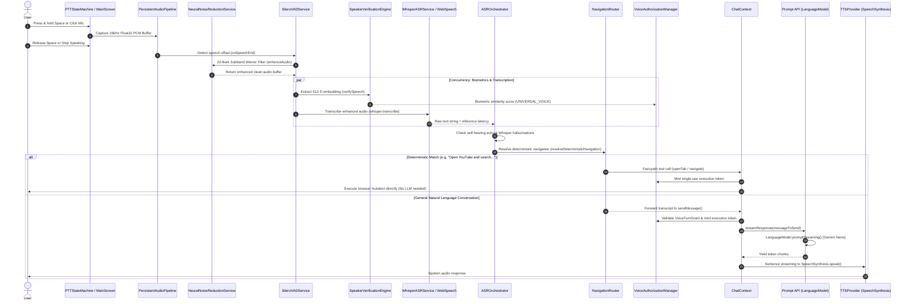
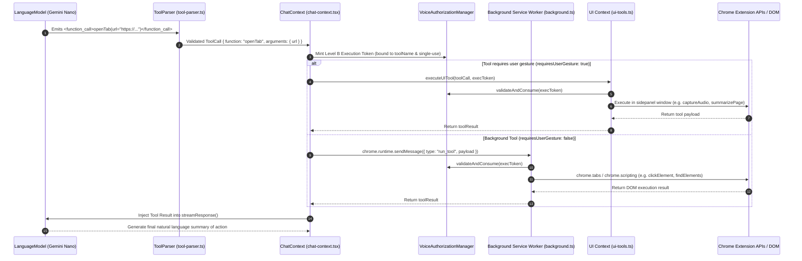

# Pentone AI Data Flow & Execution Traces
**Document Type:** Technical Architecture Audit (Read-Only)  
**Target Repository:** Pentone MV3 Voice Browser Assistant  
**Branch:** `feature/browser-tools-reliability`  
**Execution Timestamp:** 2026-11-02T01:17:00Z  

---

## 1. Executive Summary

This document provides complete, line-by-line execution traces of Pentone's data flow during:
1. **Normal Spoken Conversation:** From Push-to-Talk activation to speech synthesis output.
2. **Deterministic Fast-Path Navigation:** Direct rule-based routing bypassing the LLM.
3. **Agent Reasoning & Tool Orchestration Loop:** How the LLM selects, validates, authorizes, and executes browser tools.

---

## 2. Normal Speech Conversation: Complete End-to-End Trace

The sequence below details the execution path when a user speaks to Pentone and receives an AI response.

### Stage-by-Stage Implementation Details

#### Stage 1: Trigger & Capture
- **Source:** [`lib/audio/ptt-state-machine.ts`](file:///c:/project/New%20folder/Marionette/lib/audio/ptt-state-machine.ts) & [`lib/audio/use-full-duplex-voice.ts`](file:///c:/project/New%20folder/Marionette/lib/audio/use-full-duplex-voice.ts#L68-L150)
- **Functions:** `handleKeyDown` (Space detection, checks `!isEditableElement(target)`), `startPtt()`, `stopPtt()`
- **Action:** Directs `PersistentAudioPipeline` to collect 16 kHz Float32Array PCM audio chunks in `pttAudioChunksRef`.
- **Mode:** Asynchronous, 100% Local / Offline.

#### Stage 2: Voice Activity Detection & Boundary Extraction
- **Source:** [`lib/audio/silero-vad-service.ts`](file:///c:/project/New%20folder/Marionette/lib/audio/silero-vad-service.ts#L32-L115)
- **Model:** `Silero VAD` (`assets/silero_vad_*.onnx`) via `@ricky0123/vad-web`.
- **Action:** Evaluates frame probabilities; fires `onSpeechStart` (instantly interrupting any playing TTS) and `onSpeechEnd` when silence exceeds 250ms (`redemptionMs`). Returns concatenated Float32Array speech buffer.

#### Stage 3: Noise Reduction (DSP Speech Enhancement)
- **Source:** [`lib/audio/neural-noise-reduction-service.ts`](file:///c:/project/New%20folder/Marionette/lib/audio/neural-noise-reduction-service.ts#L39-L150)
- **Function:** `neuralNoiseReductionService.enhanceAudio(audioBuffer)`
- **Mechanism:** Short-Time Fourier Transform (STFT) with 320-point Hann window, 22 Bark critical auditory subbands, recursive minimum statistics noise floor estimation, parametric Wiener gain filtering.
- **Weights:** Zero neural weights. Classical deterministic DSP.

#### Stage 4: Biometric Authentication & Capability Minting
- **Source:** [`lib/audio/speaker-verification-engine.ts`](file:///c:/project/New%20folder/Marionette/lib/audio/speaker-verification-engine.ts#L46-L150) & [`lib/audio/voice-authorization-manager.ts`](file:///c:/project/New%20folder/Marionette/lib/audio/voice-authorization-manager.ts)
- **Model:** `CAM++` (`assets/cam_speaker.onnx`) running via single-threaded ONNX Runtime WASM.
- **Action:** Evaluates 512-dimensional bottleneck embedding against enrolled profile. Issues a signed Level A `VoiceTurnGrant` with monotonic turn ID and maximum capability scope (`UNIVERSAL_VOICE`).

#### Stage 5: Speech Transcription (ASR)
- **Path A (Local Offline):** [`lib/audio/whisper-asr-service.ts`](file:///c:/project/New%20folder/Marionette/lib/audio/whisper-asr-service.ts#L80-L210)
  - **Model:** `Xenova/whisper-tiny.en` via `@xenova/transformers`.
  - **Runtime:** ONNX WASM running locally in sidepanel thread.
- **Path B (Browser/Cloud Web Speech):** [`lib/use-speech-recognition.ts`](file:///c:/project/New%20folder/Marionette/lib/use-speech-recognition.ts#L94-L120)
  - **API:** `window.webkitSpeechRecognition`.

#### Stage 6: Echo Filtering & Intent Routing
- **Source:** [`lib/audio/asr-intent-orchestrator.ts`](file:///c:/project/New%20folder/Marionette/lib/audio/asr-intent-orchestrator.ts#L33-L120) & [`lib/navigation-router.ts`](file:///c:/project/New%20folder/Marionette/lib/navigation-router.ts)
- **Action:**
  - Jaccard token overlap filter rejects microphone self-hearing echo of recent assistant utterances (`TTSAcousticTracker`).
  - Regex pattern matching filters out Whisper silence hallucinations (`"Thank you for watching"`, `"[Music]"`).
  - Deterministic router inspects query for direct navigation intents (`resolveDeterministicNavigation`).

#### Stage 7: LLM Reasoning & Response Generation
- **Source:** [`lib/chat-context.tsx`](file:///c:/project/New%20folder/Marionette/lib/chat-context.tsx#L966-L986) & [`lib/ai.ts`](file:///c:/project/New%20folder/Marionette/lib/ai.ts#L174-L264)
- **Function:** `streamResponse(messageToSend, onChunk, toolResult)`
- **Model:** Google Chrome Prompt API (`window.LanguageModel`).
- **Session:** Pre-warmed resident session (`createResilientSession`) configured with system prompt (`lib/prompts/system-prompt.ts`) containing all 27 tool specifications.
- **Streaming:** Tokens streamed incrementally to the chat UI and TTS sentence splitter.

#### Stage 8: Speech Output (TTS)
- **Source:** [`lib/tts-context.tsx`](file:///c:/project/New%20folder/Marionette/lib/tts-context.tsx#L71-L150) & [`lib/sentence-parser.ts`](file:///c:/project/New%20folder/Marionette/lib/sentence-parser.ts)
- **API:** `window.speechSynthesis` (Web Speech API).
- **Action:** Splices incoming token stream into punctuation-delimited sentences (`splitIntoSentences`) and enqueues utterances to `SpeechSynthesisUtterance`.

---

## 3. Browser Tool Execution Data Flow

When the Prompt API determines that a browser mutation or inspection is necessary, it emits a structured function call.

### Authorization Enforcement Details
1. **Turn Grant (Level A):** Validates that speech originated from an intentional user interaction (PTT hold or active wake-word window) with valid CAM++ speaker verification.
2. **Execution Token (Level B):** Minted immediately before calling `executeTool` or `executeUITool`. Explicitly bound to `targetToolName`. Strictly single-use (`consumed: true`). Valid for a narrow time window (typically 5,000ms).
3. **Internal URL Guard:** Background handlers and scripting tools strictly check `url.startsWith('chrome://') || url.startsWith('about:') || url.startsWith('chrome-extension://')` and fail-closed with a safe error without throwing unhandled exceptions.
