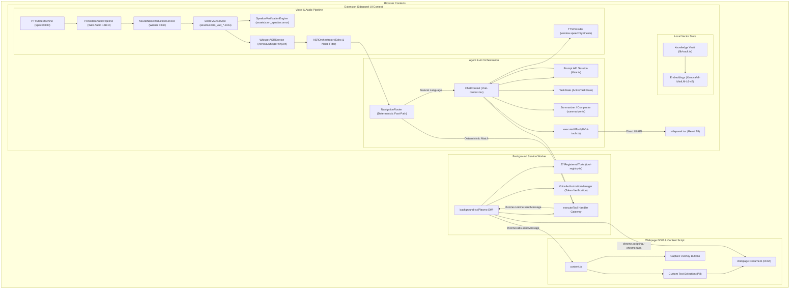

# Pentone Complete Architecture, AI Runtime & Data Flow Audit
**Document Type:** Comprehensive Technical Audit (Read-Only)  
**Target Repository:** Pentone MV3 Voice Browser Assistant  
**Branch:** `feature/browser-tools-reliability`  
**Execution Timestamp:** 2026-11-02T01:18:30Z  

---

## 1. Executive Summary & Audit Mandate

This technical audit provides an exhaustive, code-level analysis of the Pentone browser extension codebase. It directly answers the user's primary inquiry:

> **"Pentone's normal speech/conversation functionality is working, so which AI models and runtime components make that possible, and can the same existing AI infrastructure power webpage summarization, webpage understanding, and other browser intelligence features?"**

### Primary Architectural Conclusions
1. **Normal Speech & Voice Pipeline Does NOT Rely on Gemini Nano:**
   Normal speech capture, noise reduction, voice activity detection (VAD), speaker authentication, and transcription execute entirely via a **hybrid local/browser stack**:
   - Audio Pipeline & DSP: `PersistentAudioPipeline` + classical 22-Bark subband Wiener filtering (`NeuralNoiseReductionService`).
   - Voice Activity Detection: `Silero VAD` (`assets/silero_vad_*.onnx` via `@ricky0123/vad-web`).
   - Biometric Voice ID: `CAM++` (`assets/cam_speaker.onnx` via ONNX Runtime Web).
   - Speech Recognition (ASR): Local `Whisper` (`Xenova/whisper-tiny.en` via `@xenova/transformers` ONNX WASM) or Web Speech API (`webkitSpeechRecognition`).
   - Deterministic Fast-Path: `NavigationRouter` regex rules route common commands (`openTab`, etc.) directly without invoking any LLM.
2. **Normal AI Conversational Reasoning Uses Chrome's Prompt API:**
   When an LLM is required for dialogue or tool orchestration, Pentone uses Google Chrome's built-in **Prompt API** (`window.LanguageModel`), backed by Gemini Nano / Gemma resident in browser memory.
3. **The Root Cause of Summarization Failure:**
   The `summarizePage` tool in `lib/ui-tools.ts` explicitly attempts to invoke Chrome's experimental `window.Summarizer` API, falling back to an isolated `window.LanguageModel` session. In Google Chrome for Testing (CfT) 156, both APIs time out because open-source Chromium and CfT builds do not bundle Google's proprietary **Omaha ComponentUpdater** network (`chrome://components` is empty). The model weights (~1.7 GB) cannot be downloaded dynamically.
4. **Feasibility of Reusing Existing AI Infrastructure:**
   **100% Feasible.** Pentone already possesses:
   - A robust DOM extraction pipeline (`Readability.js` + specialized extractors).
   - An in-page Text Explainer (`useTextExplainer.ts`) that successfully summarizes arbitrary text using the resident Prompt API.
   - An integrated `@xenova/transformers` ONNX WebAssembly runtime that already runs local embeddings (`all-MiniLM-L6-v2`) and local speech transcription (`whisper-tiny.en`).
   By routing page summarization through the existing resident AI engine or a local Transformers.js pipeline, Pentone can achieve complete offline summarization with zero additional API costs or external model dependencies.

---

## 2. High-Level System Architecture Diagram

---

## 3. Subsystem Breakdown (16 Core Subsystems)

### 1. Frontend Architecture
- **Purpose:** Manages reactive UI screens, audio waveforms, turn diagnostics, and message display.
- **Source Files:** [`sidepanel.tsx`](file:///c:/project/New%20folder/Marionette/sidepanel.tsx), [`screens/main-screen.tsx`](file:///c:/project/New%20folder/Marionette/screens/main-screen.tsx), [`screens/chat-screen.tsx`](file:///c:/project/New%20folder/Marionette/screens/chat-screen.tsx), [`components/waveform.tsx`](file:///c:/project/New%20folder/Marionette/components/waveform.tsx).
- **Tech Stack:** React 18.2.0, Tailwind CSS, Lucide icons, Framer Motion, Anime.js, Radix UI Themes.
- **Context:** Sidepanel UI context (`chrome-extension://.../sidepanel.html`).

### 2. Chrome Extension Manifest V3 Architecture
- **Purpose:** Complies with modern Chrome MV3 security boundaries.
- **Framework:** Plasmo (`plasmo: 0.90.5`).
- **Manifest Permissions:** `tabs`, `activeTab`, `tabCapture`, `scripting`, `storage`, `unlimitedStorage`, `sidePanel`, `webNavigation`.
- **Host Permissions:** `https://*/*`, `<all_urls>`.
- **Content Security Policy:** `script-src 'self' 'wasm-unsafe-eval'; object-src 'self'; worker-src 'self';`.

### 3. Sidepanel Architecture
- **Purpose:** Primary user interface for voice interaction, history, diagnostics, and settings.
- **Source Files:** [`sidepanel.tsx`](file:///c:/project/New%20folder/Marionette/sidepanel.tsx), [`lib/chat-context.tsx`](file:///c:/project/New%20folder/Marionette/lib/chat-context.tsx).
- **State Tree:** Nested React providers: `ThemeProvider` -> `AlertProvider` -> `OnboardingProvider` -> `MediaDeviceProvider` -> `TTSProvider` -> `ChatProvider`.

### 4. Background Service Worker
- **Purpose:** Manages extension lifecycle, executes privileged Chrome API tools, handles tab navigation and auto-capture.
- **Source Files:** [`background.ts`](file:///c:/project/New%20folder/Marionette/background.ts).
- **Execution Context:** Service Worker (`background/index.js`). No direct DOM or window access.

### 5. Content Scripts
- **Purpose:** In-page DOM manipulation, floating selection tooltips, text rewriting replacement, keyboard shortcuts.
- **Source Files:** [`content.ts`](file:///c:/project/New%20folder/Marionette/content.ts), [`components/custom-text-selection.tsx`](file:///c:/project/New%20folder/Marionette/components/custom-text-selection.tsx).
- **Shortcuts:** `Ctrl+Shift+S` (screenshot), `Ctrl+Shift+A` (audio capture), `Ctrl+Shift+E` (text actions).

### 6. Voice Pipeline
- **Purpose:** Persistent 16 kHz microphone capture, acoustic noise suppression, voice activity detection, and barge-in interruption.
- **Source Files:** [`lib/audio/persistent-audio-pipeline.ts`](file:///c:/project/New%20folder/Marionette/lib/audio/persistent-audio-pipeline.ts), [`lib/audio/neural-noise-reduction-service.ts`](file:///c:/project/New%20folder/Marionette/lib/audio/neural-noise-reduction-service.ts), [`lib/audio/silero-vad-service.ts`](file:///c:/project/New%20folder/Marionette/lib/audio/silero-vad-service.ts), [`lib/audio/barge-in-controller.ts`](file:///c:/project/New%20folder/Marionette/lib/audio/barge-in-controller.ts).
- **Features:** 8-state barge-in state machine; interrupts TTS within ~50ms of human speech onset.

### 7. Speech Recognition and Transcription
- **Purpose:** Transcribes spoken audio into text strings.
- **Source Files:** [`lib/audio/whisper-asr-service.ts`](file:///c:/project/New%20folder/Marionette/lib/audio/whisper-asr-service.ts), [`lib/use-speech-recognition.ts`](file:///c:/project/New%20folder/Marionette/lib/use-speech-recognition.ts), [`lib/audio/asr-intent-orchestrator.ts`](file:///c:/project/New%20folder/Marionette/lib/audio/asr-intent-orchestrator.ts).
- **Engines:** Local Whisper (`Xenova/whisper-tiny.en` via ONNX WASM) and Web Speech API (`webkitSpeechRecognition`).

### 8. AI Inference and Reasoning
- **Purpose:** Core agent intelligence, conversational dialogue, task planning, tool selection, and context compaction.
- **Source Files:** [`lib/ai.ts`](file:///c:/project/New%20folder/Marionette/lib/ai.ts), [`lib/ai-config.ts`](file:///c:/project/New%20folder/Marionette/lib/ai-config.ts), [`lib/prompts/system-prompt.ts`](file:///c:/project/New%20folder/Marionette/lib/prompts/system-prompt.ts).
- **Model:** Chrome Prompt API (`window.LanguageModel` / Gemini Nano). 9,216 token quota, proactive compaction at 5,500 tokens.

### 9. Tool Registry and Execution Engine
- **Purpose:** Declares, documents, parses, and executes all 27 browser tools.
- **Source Files:** [`lib/tool-registry.ts`](file:///c:/project/New%20folder/Marionette/lib/tool-registry.ts), [`lib/tool-parser.ts`](file:///c:/project/New%20folder/Marionette/lib/tool-parser.ts), [`lib/tools.ts`](file:///c:/project/New%20folder/Marionette/lib/tools.ts), [`lib/ui-tools.ts`](file:///c:/project/New%20folder/Marionette/lib/ui-tools.ts).
- **Dispatching:** Tools with `requiresUserGesture: true` (5 tools) routed to `executeUITool`; remaining 22 tools routed to `executeTool` (background worker).

### 10. Authorization and Speaker Verification
- **Purpose:** Biometric voice authentication and fail-closed capability security.
- **Source Files:** [`lib/audio/speaker-verification-engine.ts`](file:///c:/project/New%20folder/Marionette/lib/audio/speaker-verification-engine.ts), [`lib/audio/voice-authorization-manager.ts`](file:///c:/project/New%20folder/Marionette/lib/audio/voice-authorization-manager.ts).
- **Model:** CAM++ (`assets/cam_speaker.onnx`). Issues signed Level A `VoiceTurnGrant` and single-use Level B `VoiceAuthorizationToken`.

### 11. Memory and Knowledge Vault
- **Purpose:** Semantic storage and retrieval of personal facts, preferences, and saved web pages.
- **Source Files:** [`lib/vault.ts`](file:///c:/project/New%20folder/Marionette/lib/vault.ts), [`lib/embeddings.ts`](file:///c:/project/New%20folder/Marionette/lib/embeddings.ts), [`lib/tools/storeMemory.ts`](file:///c:/project/New%20folder/Marionette/lib/tools/storeMemory.ts).
- **Model:** `Xenova/all-MiniLM-L6-v2` (384 dimensions) via `@xenova/transformers`.

### 12. Browser Automation System
- **Purpose:** DOM inspection, semantic element finding, input population, element clicking, keyboard dispatch, scrolling, and tab management.
- **Source Files:** [`lib/tools/openTab.ts`](file:///c:/project/New%20folder/Marionette/lib/tools/openTab.ts), [`lib/tools/clickElement.ts`](file:///c:/project/New%20folder/Marionette/lib/tools/clickElement.ts), [`lib/tools/fillInput.ts`](file:///c:/project/New%20folder/Marionette/lib/tools/fillInput.ts), [`lib/tools/findElements.ts`](file:///c:/project/New%20folder/Marionette/lib/tools/findElements.ts), [`lib/tools/getAccessibilitySnapshot.ts`](file:///c:/project/New%20folder/Marionette/lib/tools/getAccessibilitySnapshot.ts), [`lib/tools/pressKey.ts`](file:///c:/project/New%20folder/Marionette/lib/tools/pressKey.ts).
- **Safety Invariance:** Strict internal URL guards (`chrome://`, `about:`, `chrome-extension://`).

### 13. Screenshot and Page-Content Extraction
- **Purpose:** Captures viewport screenshots and extracts clean semantic article text.
- **Source Files:** [`lib/tools/captureScreenshot.ts`](file:///c:/project/New%20folder/Marionette/lib/tools/captureScreenshot.ts), [`assets/Readability.js`](file:///c:/project/New%20folder/Marionette/assets/Readability.js), [`lib/ui-tools.ts`](file:///c:/project/New%20folder/Marionette/lib/ui-tools.ts#L60-L202).
- **Extraction:** Readability.js + custom YouTube metadata extractors.

### 14. Storage and Persistence
- **Purpose:** Persists chat sessions, user settings, speaker profiles, and memory vaults.
- **Storage Backend:** `chrome.storage.local`.
- **Storage Keys:** `pentone_settings`, `pentone_memories`, `pentone_vault`, `pentone_speaker_profiles`, `chat_history`.

### 15. External Services and APIs
- **Design Philosophy:** **100% Local-First Offline.**
- **Network Boundaries:**
  - Zero external cloud LLM APIs (no OpenAI, no Anthropic, no Google Gemini Cloud API keys).
  - Web Speech API connects to Google speech services only when local speech pack is missing in Chrome.
  - Hugging Face CDN accessed once on initial install to download Whisper and MiniLM weights.
  - Google Omaha ComponentUpdater distributes Gemini Nano in consumer Chrome.

### 16. Build and Deployment Pipeline
- **Bundler:** Plasmo 0.90.5 + Parcel.
- **Compilation:** TypeScript 5.3.3, Tailwind CSS 3.4.17.
- **Build Target:** `build/chrome-mv3-prod`.

---

## 4. Reconciled 27-Tool Registry Architecture

The table below catalogs every tool registered in `lib/tool-registry.ts`:

| # | Tool Name | Execution Context | User Gesture Required? | Primary Action / Chrome API | Security Classification |
|---|-----------|:-----------------:|:----------------------:|-----------------------------|-------------------------|
| 1 | `think` | Background | No | Internal reasoning trace (stripped from user text) | `READ_ONLY_INFORMATIONAL` |
| 2 | `getPageTitle` | Background | No | `chrome.tabs.get` / `document.title` fallback | `READ_ONLY_INFORMATIONAL` |
| 3 | `openTab` | Background | No | `chrome.tabs.create` | `SAFE_NAVIGATION` |
| 4 | `closeTab` | Background | No | `chrome.tabs.remove` | `EXECUTE_MUTATING_ACTIONS` |
| 5 | `switchTab` | Background | No | `chrome.tabs.update({ active: true })` | `EXECUTE_MUTATING_ACTIONS` |
| 6 | `getTabs` | Background | No | `chrome.tabs.query` | `READ_ONLY_INFORMATIONAL` |
| 7 | `captureScreenshot` | Background | No | `chrome.tabs.captureVisibleTab` | `READ_ONLY_INFORMATIONAL` |
| 8 | `getAccessibilitySnapshot` | Background | No | `chrome.scripting.executeScript` (semantic DOM tree) | `READ_ONLY_INFORMATIONAL` |
| 9 | `findElements` | Background | No | `chrome.scripting.executeScript` (CSS query selector) | `READ_ONLY_INFORMATIONAL` |
| 10 | `clickElement` | Background | No | `chrome.scripting.executeScript` (synthetic DOM click) | `EXECUTE_MUTATING_ACTIONS` |
| 11 | `fillInput` | Background | No | `chrome.tabs.sendMessage` -> `content.ts` (DOM input) | `MUTATING_CONTENT` |
| 12 | `scrollDown` | Background | No | `chrome.scripting.executeScript(scrollBy)` | `SAFE_NAVIGATION` |
| 13 | `scrollUp` | Background | No | `chrome.scripting.executeScript(scrollBy)` | `SAFE_NAVIGATION` |
| 14 | `pressKey` | Background | No | `chrome.scripting.executeScript(dispatchEvent)` | `EXECUTE_MUTATING_ACTIONS` |
| 15 | `listen` | Background | No | Captures live tab audio stream | `READ_ONLY_INFORMATIONAL` |
| 16 | `captureAudio` | **UI Context** | **Yes** | `chrome.tabCapture.getMediaStreamId` | `READ_ONLY_INFORMATIONAL` |
| 17 | `summarizePage` | **UI Context** | **Yes** | Readability.js + `window.Summarizer` / `window.LanguageModel` | `READ_ONLY_INFORMATIONAL` |
| 18 | `writeContent` | **UI Context** | **Yes** | `window.Writer.write` | `MUTATING_CONTENT` |
| 19 | `translateText` | **UI Context** | **Yes** | `window.Translator.translate` | `READ_ONLY_INFORMATIONAL` |
| 20 | `detectLanguage` | **UI Context** | **Yes** | `window.LanguageDetector.detect` | `READ_ONLY_INFORMATIONAL` |
| 21 | `storeMemory` | Background | No | Generates embedding -> `chrome.storage.local` | `MUTATING_CONTENT` |
| 22 | `getMemories` | Background | No | Retrieves memories from `chrome.storage.local` | `READ_ONLY_INFORMATIONAL` |
| 23 | `highlightSelector` | Background | No | `chrome.scripting.executeScript` (adds CSS outline) | `READ_ONLY_INFORMATIONAL` |
| 24 | `highlightText` | Background | No | `chrome.scripting.executeScript` (highlights text) | `READ_ONLY_INFORMATIONAL` |
| 25 | `captureCurrentPage` | Background | No | Extracts text and writes to knowledge vault | `MUTATING_CONTENT` |
| 26 | `searchVault` | Background | No | Computes query vector -> cosine similarity search | `READ_ONLY_INFORMATIONAL` |
| 27 | `getVaultStats` | Background | No | Returns document counts and storage usage | `READ_ONLY_INFORMATIONAL` |

---

## 5. Security, Privacy & Cost Assessment

1. **Audio Privacy:**
   - In PTT mode with local Whisper (`WhisperASRService`), microphone audio is processed **100% locally on-device**. No audio frames leave the browser.
   - When using `webkitSpeechRecognition`, audio is streamed to Google speech servers under standard Chrome browser terms.
2. **Webpage Content Privacy:**
   - Webpage content extracted by `Readability.js` stays entirely inside the user's browser memory.
   - Inferences performed by Chrome's Built-in AI (`window.LanguageModel`) run on-device via the local `OptimizationGuideOnDeviceModel` process.
   - **Zero webpage data is transmitted to external AI providers (OpenAI, Anthropic, or external cloud endpoints).**
3. **Financial Cost:**
   - **$0.00 usage cost.** Pentone relies exclusively on local WebAssembly models and Chrome Built-in AI APIs. There are no paid API subscriptions or token metering.

---

## 6. Audit Verification & Deliverables Summary

The technical investigation generated the following comprehensive audit artifacts:
1. [`reports/PENTONE_COMPLETE_ARCHITECTURE_AND_AI_AUDIT.md`](file:///c:/project/New%20folder/Marionette/reports/PENTONE_COMPLETE_ARCHITECTURE_AND_AI_AUDIT.md) — Master architecture report.
2. [`reports/PENTONE_AI_MODEL_INVENTORY.md`](file:///c:/project/New%20folder/Marionette/reports/PENTONE_AI_MODEL_INVENTORY.md) — Exhaustive 14-component model inventory.
3. [`reports/PENTONE_AI_DATA_FLOW.md`](file:///c:/project/New%20folder/Marionette/reports/PENTONE_AI_DATA_FLOW.md) — Execution traces and Mermaid diagrams.
4. [`reports/PENTONE_SUMMARIZATION_ROOT_CAUSE.md`](file:///c:/project/New%20folder/Marionette/reports/PENTONE_SUMMARIZATION_ROOT_CAUSE.md) — Line-by-line root cause analysis of summarization failure.
5. [`reports/PENTONE_AI_REUSE_FEASIBILITY.md`](file:///c:/project/New%20folder/Marionette/reports/PENTONE_AI_REUSE_FEASIBILITY.md) — Unified AI engine reuse feasibility and architectural options.
