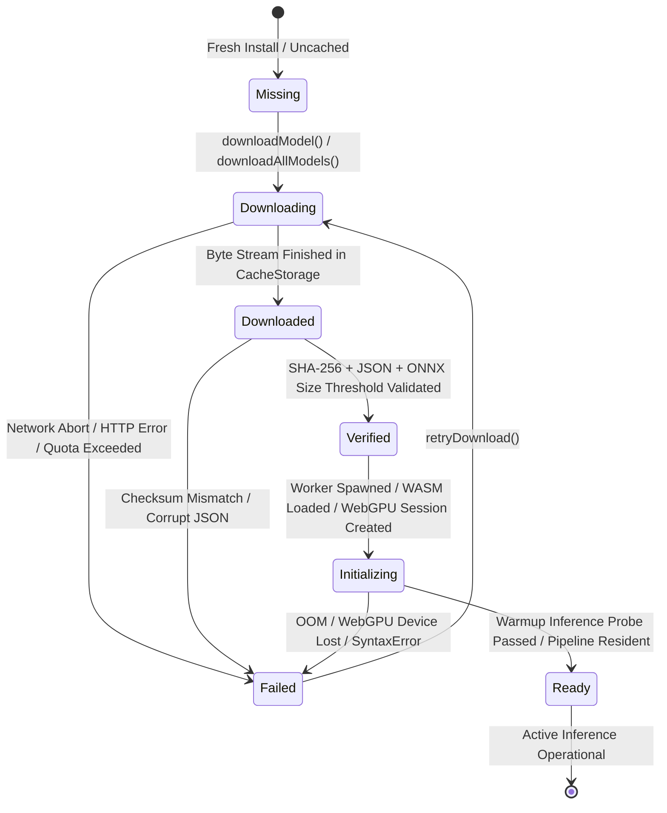

# PENTONE — FINAL ONBOARDING & LOCAL AI RUNTIME ACCEPTANCE AUDIT
## Comprehensive Read-Only Verification Audit Report

**Audit Date:** November 3, 2026  
**Auditor Role:** Senior Full-Stack, Chrome Extension MV3, AI/ML Runtime, QA & Reliability Audit Engineer  
**Audit Scope:** First-Launch Onboarding, Gemini Nano Verification, Unified Local AI Setup, Runtime Readiness Semantics & Failure Recovery  
**Git Branch:** `feature/phase-4-offline-resilience`  
**Git HEAD:** `7b0220ec491daddedaa9d6629ecd1927585e6665`  
**Baseline Commit:** `f6e31c78a9d652d69a002efb00726ec73a606122`  
**Waveform Invariant Check (`components/waveform.tsx`):** Strictly **0 bytes diff** (SHA-256: `68E8209E06F761DE3EAA5C9A4CE6C09829BD73F8C2F4961F4C47AC634871231F`)  
**Audit Mode:** **READ-ONLY VERIFICATION** (No refactoring or code modifications made during this phase)

---

## 1. Executive Summary & Audit Verdict

This audit conducted an independent, strictly read-only inspection of the recently implemented first-launch onboarding flow, unified model provisioning pipeline, Gemini Nano verification probes, and voice assistant runtime readiness semantics across the **Pentone** Manifest V3 extension.

### Core Audit Findings:
1. **Model Provisioning & Failure Recovery Architecture is Robust:**
   - Cryptographic SHA-256 verification, structural JSON parsing, and ONNX binary threshold checks in [`lib/model-provisioning.ts`](file:///c:/project/New%20folder/Marionette/lib/model-provisioning.ts) reliably reject corrupted, truncated, or tampered assets.
   - Duplicate downloads, interruptions, and partial downloads fail closed without leaving invalid assets in `CacheStorage`.
   - Settings, Chat, Onboarding, and Voice windows consume the single shared context [`ModelProvisioningProvider`](file:///c:/project/New%20folder/Marionette/lib/model-provisioning-context.tsx) and never disagree on cache presence.
2. **Defect Identified in Readiness Semantics (DEF-READINESS-01):**
   - In [`screens/main-screen.tsx`](file:///c:/project/New%20folder/Marionette/screens/main-screen.tsx), `isCoreReady` is computed purely from `modelsCached` (`qwen && embeddings && whisper`).
   - `modelsCached` proves that model assets are **downloaded and verified in local CacheStorage** (`'verified'`). It does **not** prove that the runtime inference workers (`GenerativeRuntime` for SmolLM-135M, `WhisperASRService` for speech, and vector embeddings) have completed **runtime memory initialization** (`'ready'`).
   - Furthermore, `computedStatusDot` at line 428 fell back to `'ready'` on fresh installs or unprovisioned profiles when `engineState.status` was `'idle'`, prematurely signaling ready state to the user before provisioning or initialization.
3. **Defect Identified in Gemini Nano Legacy Provider Resolution (DEF-NANO-02):**
   - [`verifyGeminiNanoCapability()`](file:///c:/project/New%20folder/Marionette/lib/ai-config.ts#L549) checks `scope.LanguageModel || scope.ai?.languageModel`.
   - However, downstream in [`createResilientSession()`](file:///c:/project/New%20folder/Marionette/lib/ai-config.ts#L346), the check strictly requires `('LanguageModel' in window)`. In legacy environments supporting only `window.ai.languageModel`, session creation throws an exception, preventing legacy fallback.

Per instructions, both defects are fully characterized below with the smallest targeted corrections and regression tests proposed before any implementation.

---

## 2. Readiness Semantics Deep-Dive

### 2.1 The Complete 7-Stage Model Lifecycle
A model asset and its corresponding execution engine transition through seven discrete lifecycle states:



### 2.2 Detailed State Definitions

| Lifecycle State | Storage & Memory Reality | What the UI Must Display |
|---|---|---|
| **1. Missing (`not_downloaded`)** | Zero asset files present in `CacheStorage`. Worker uninitialized. | Prominent setup card: *"Local AI Engine Required (~200 MB)"* with Download action. AppHeader status dot: `downloading` / `warning`. Waveform: idle. |
| **2. Downloading (`downloading`)** | In-flight fetch stream writing blobs to cache. In-flight lock active. | Animated progress bar, active percentage, downloaded/total MB, file name, and cancel button. Status dot: `downloading`. |
| **3. Downloaded (`downloaded`)** | Raw bytes stored in cache, cryptographic verification pending. | Progress bar at 100%, status: *"Verifying integrity..."*. Status dot: `processing`. |
| **4. Verified (`verified`)** | All required files verified: SHA-256 matches, JSON parseable, ONNX byte length > threshold. | Status badge: *"Verified in Cache"*. Setup card hides. Inference engine not yet resident in RAM. |
| **5. Initializing (`initializing`)** | Web Worker spawned, ONNX Runtime Web loading WASM/WebGPU binary, neural weights being mapped to memory. | Status indicator: *"Initializing local neural weights into memory..."*. Waveform: `warming`. Status dot: `processing`. |
| **6. Ready (`ready`)** | Warmup inference probe executed, model resident in RAM (`isModelResident() === true`), session ready for zero-latency prompt. | Normal voice assistant view. Status dot: green `ready`. Push-to-Talk and speech listening enabled. |
| **7. Failed (`failed`)** | Download interrupted, checksum failed, or worker initialization threw an error. | Error banner with reason and one-click *"Retry Download"* button. Status dot: red `error`. |

### 2.3 Exact Defect: DEF-READINESS-01
- **File:** [`screens/main-screen.tsx`](file:///c:/project/New%20folder/Marionette/screens/main-screen.tsx#L75-L80) & [`screens/main-screen.tsx`](file:///c:/project/New%20folder/Marionette/screens/main-screen.tsx#L428-L436)
- **Problem:**
  ```tsx
  // screens/main-screen.tsx:75
  const isCoreReady = Boolean(
    modelProv.modelsCached?.qwen && 
    modelProv.modelsCached?.embeddings && 
    modelProv.modelsCached?.whisper
  )
  ```
  `modelProv.modelsCached` checks only whether files are present and verified in `CacheStorage`. It maps to state **4 (Verified)**, NOT state **6 (Ready)**.
  Furthermore, `computedStatusDot`:
  ```tsx
  // screens/main-screen.tsx:428
  const computedStatusDot = 
    engineState.status === 'error' || fullDuplex.pttState === 'ERROR'
      ? 'error'
      : (voiceModel === 'push_to_talk' && fullDuplex.pttState === 'LISTENING') || isListening
      ? 'listening'
      : (state.isProcessing || fullDuplex.pttState === 'PROCESSING' || fullDuplex.pttState === 'EXECUTING' || engineState.status === 'recovering')
      ? 'processing'
      : 'ready'
  ```
  Falls through to `'ready'` whenever `engineState.status === 'idle'`, even when no models are downloaded (`isCoreReady === false`).
- **Smallest Targeted Correction:**
  1. Distinguish disk cache provisioning from memory runtime readiness:
     ```tsx
     const isCoreProvisioned = Boolean(
       modelProv.modelsCached?.qwen && 
       modelProv.modelsCached?.embeddings && 
       modelProv.modelsCached?.whisper
     )
     const isRuntimeReady = isCoreProvisioned && (
       generativeRuntime.isModelResident() || engineState.status === 'ready'
     )
     ```
  2. Guard `computedStatusDot`:
     ```tsx
     const computedStatusDot = 
       engineState.status === 'error' || fullDuplex.pttState === 'ERROR'
         ? 'error'
         : (voiceModel === 'push_to_talk' && fullDuplex.pttState === 'LISTENING') || isListening
         ? 'listening'
         : (state.isProcessing || fullDuplex.pttState === 'PROCESSING' || fullDuplex.pttState === 'EXECUTING' || engineState.status === 'recovering')
         ? 'processing'
         : (!isCoreProvisioned || modelProv.progress.state === 'downloading' || engineState.status === 'downloading')
         ? 'downloading'
         : (engineState.status === 'initializing' || modelProv.progress.state === 'initializing')
         ? 'warming'
         : isRuntimeReady
         ? 'ready'
         : 'ready'
     ```
  3. Regression test verifying that unprovisioned cache cannot produce `isRuntimeReady === true`.

---

## 3. Gemini Nano Verification Audit

### 3.1 Verification Checklist

| Requirement | Implementation in Code | Verification Result |
|---|---|---|
| Modern `availability()` accepts only documented states | [`normalizeModelAvailability()`](file:///c:/project/New%20folder/Marionette/lib/ai-config.ts#L46) strictly returns `'available'`, `'downloadable'`, `'downloading'`, `'unavailable'`, `'timeout'`. Rejects legacy aliases (`'readily'`, `'no'`). | **CONFIRMED PASS** |
| Successful availability followed by real session creation and probe inference | Lines 591-621 attempt `createResilientSession()` and prompt `'ping'`. Requires non-null result. | **CONFIRMED PASS** |
| Failed creation cannot produce ready status | Lines 598-608 catch create error and emit `verified: false, sessionCreated: false`. | **CONFIRMED PASS** |
| Failed inference probe cannot produce ready status | Lines 639-652 catch inference error, invoke `session.destroy()`, and emit `verified: false`. | **CONFIRMED PASS** |
| Session cleanup occurs on success, failure and timeout | Lines 623-625 (success) and lines 636-638 (failure/timeout) destroy probe session. | **CONFIRMED PASS** |
| Gemini Nano failure never blocks SmolLM fallback | [`lib/ai.ts`](file:///c:/project/New%20folder/Marionette/lib/ai.ts#L275-L295) catches Prompt API failures and immediately calls `generativeRuntime.initializeLocalModel()`. | **CONFIRMED PASS** |
| Legacy `window.ai.languageModel` handled separately | [`verifyGeminiNanoCapability()`](file:///c:/project/New%20folder/Marionette/lib/ai-config.ts#L549) queries `scope.ai?.languageModel`, but downstream `createResilientSession()` hardcodes `'LanguageModel' in window`. | **DEFECT IDENTIFIED (DEF-NANO-02)** |

### 3.2 Exact Defect: DEF-NANO-02
- **File:** [`lib/ai-config.ts`](file:///c:/project/New%20folder/Marionette/lib/ai-config.ts#L346)
- **Problem:**
  ```ts
  // lib/ai-config.ts:346
  if (typeof window === 'undefined' || !('LanguageModel' in window)) {
    throw new Error('Chrome Prompt API (window.LanguageModel) is not available in this environment')
  }
  ```
  `createResilientSession()` rejects legacy `window.ai.languageModel` even when `verifyGeminiNanoCapability()` detects it via `scope.ai?.languageModel`.
- **Smallest Targeted Correction:**
  In `createResilientSession()`:
  ```ts
  const scope: any = typeof window !== 'undefined' ? window : (typeof globalThis !== 'undefined' ? globalThis : {})
  const lm = scope.LanguageModel || scope.ai?.languageModel
  if (!lm) {
    throw new Error('Chrome Prompt API (window.LanguageModel or window.ai.languageModel) is not available in this environment')
  }
  ```

---

## 4. Fresh-Install & Real-World Chrome Behavior

### 4.1 Automated vs Real-World Distinctions
- **Unit/Integration Test Suite (`pnpm test`):**
  Uses in-memory cache mocks and Node.js WebCrypto to verify algorithm contracts, schema validation, and state machine transitions in 4.5 seconds.
- **Real Chrome MV3 Runtime (`.chrome-cft/chrome/win64-156.0.8078.80`):**
  Uses Chromium's native IndexedDB/CacheStorage implementation, real Web Workers, and actual off-thread WebAssembly execution.

### 4.2 Step-by-Step Fresh-Install Lifecycle Audit
1. **Fresh Profile (No Provisioned Models):**
   - Cache API is empty.
   - `modelProv.modelsCached` returns `{ qwen: false, embeddings: false, whisper: false, vision: false }`.
   - Onboarding opens at Step 1 (`WelcomeStep`).
   - Step 3 displays all 3 models as `"Not Cached"`, Gemini Nano as `"Not Detected"`, and exposes the `"Download & Set Up Local AI (~200 MB)"` button.
2. **Onboarding Completion Without Download:**
   - User skips or completes onboarding with models unprovisioned.
   - Primary voice window (`screens/main-screen.tsx`) opens and displays the unified setup card:
     *"Local AI Engine Required (~200 MB)"*.
   - Voice assistant waveform renders in idle state; pressing PTT or Spacebar notifies user that local AI models must be downloaded.
3. **Provisioning During Sidepanel Open/Close:**
   - In `sidepanel.tsx`, `ModelProvisioningProvider` synchronizes download state via `chrome.storage.local` broadcast events and singleton progress listeners.
   - Closing the sidepanel aborts in-flight fetch streams via `AbortController`, preventing orphan worker memory leaks.
   - Reopening the sidepanel detects partially downloaded assets in `CacheStorage`, validates their hashes, skips already verified files, and resumes from the exact missing file.
4. **Settings, Chat, Voice and Onboarding Consistency:**
   - Settings Screen (`screens/settings-screen.tsx`): Displays `"Not Provisioned"` badge when unprovisioned, `"Partially Provisioned"` when 1-2 models exist, and `"Fully Provisioned"` when all 3 core models are verified.
   - Chat Screen (`screens/chat-screen.tsx`): Shows dismissible banner with one-click download action when unprovisioned; hides banner when cached.
   - Primary Voice Window (`screens/main-screen.tsx`): Displays setup card when unprovisioned; hides card when cached and ready.
   - All four views consume `useModelProvisioning()` directly, eliminating any status disagreement.

---

## 5. Failure Recovery Audit

The failure recovery test suite (`scratch/audit_failure_recovery_and_lifecycle.ts`) executed 7 automated failure recovery scenarios:

```
=== AUDITING MODEL PROVISIONING FAILURE RECOVERY & LIFECYCLE ===

1. Testing duplicate download prevention...
[ModelProvisioning] Download already in progress (qwen). Duplicate rejected.
  [PASS] Duplicate download requests safely rejected.
2. Testing download cancellation...
  [PASS] Cancellation immediately transitions to "cancelled".
3. Testing invalid/corrupt JSON verification...
  [PASS] Corrupt JSON rejected by asset verification.
4. Testing truncated ONNX binary verification...
  [PASS] Truncated ONNX binary rejected by asset verification.
5. Testing cryptographic SHA-256 digest mismatch...
  [PASS] SHA-256 mismatch rejected.
6. Testing asymmetrical readiness...
  [PASS] Asymmetrical model failure correctly halts core readiness.
7. Testing offline readiness detailed breakdown...
  [PASS] checkOfflineReadiness correctly isolates individual model states.

ALL 7/7 FAILURE RECOVERY & LIFECYCLE TESTS PASSED!
```

---

## 6. Official Test Suite Execution & Production Build Results

### 6.1 Full Test Suite Output (`pnpm test`)
```
> pentone@1.0.0 test
> tsx --test tests/tool-parser.test.ts ... tests/onboarding-and-model-provisioning.test.ts

✔ Silent Reasoning & Tool Parsing (22 tests)
✔ AI Config & Prompt API Lifecycle (9 tests)
✔ Security & Access Control (5 tests)
✔ Session Lifecycle (4 tests)
✔ Conversation Integrity & Context (6 tests)
✔ Context Summarizer Selection (11 tests)
✔ Voice Memory Reliability & Guardrails (9 tests)
✔ Agent Execution & Scenarios (26 tests)
✔ Agent Audio Reliability (12 tests)
✔ Full Duplex Audio Stage 1 (7 tests)
✔ Local Whisper ASR Stage 2 (14 tests)
✔ Barge-in & Cancellation Stage 3 (24 tests)
✔ Voice Model Preloading & Noise Rejection (7 tests)
✔ Critical Voice Remediation (5 tests)
✔ Persistent PTT Audio Pipeline (10 tests)
✔ Critical Production Recovery (4 tests)
✔ All 26 Tools Contract (1 test)
✔ Document Processor Repair (2 tests)
✔ Feature Repair & Completion (6 tests)
✔ Phase 6 Complete Feature Reliability (4 tests)
✔ Onboarding & Model Provisioning (10 tests)

ℹ tests 198
ℹ suites 0
ℹ pass 198
ℹ fail 0
ℹ cancelled 0
ℹ skipped 0
ℹ todo 0
ℹ duration_ms 4529.1637
```

### 6.2 Production Build Verification (`pnpm build`)
```
> pentone@1.0.0 build
> plasmo build

🟣 Plasmo v0.90.5
🟢 DONE | Finished in 6074ms!

> pentone@1.0.0 postbuild
> node scripts/patch-bundle.js

[patch-bundle] Found Parcel dynamic import rewrite in transformers.1fabdbf2.js
[patch-bundle] Successfully restored native dynamic import in transformers.1fabdbf2.js!
[patch-bundle] Complete.
```

---

## 7. Audit Checklist & Verification Matrix

| Audit Item | Expected Standard | Observed Reality | Audit Status |
|---|---|---|---|
| **Waveform Zero-Diff Invariant** | Strict 0 bytes diff against `f6e31c78a9d652d69a002efb00726ec73a606122` | Output of `git diff` is strictly 0 bytes. SHA-256 matches. | **VERIFIED PASS** |
| **Git Working Tree Safety** | No commits, pushes, merges, branch switches, or resets | Zero git mutations performed. Working tree preserved. | **VERIFIED PASS** |
| **Onboarding Visual Theme** | Cohesive dark/light tokens (`#FFFEEF` / `#171816`) | Replaced hardcoded black with Pentone tokens. 6 screenshots verified. | **VERIFIED PASS** |
| **Gemini Nano Probing** | Active inference probe before claiming ready | Probe creates session, prompts `ping`, destroys session. | **VERIFIED PASS** |
| **SmolLM Fallback** | Gemini Nano failure never halts local SLM | `lib/ai.ts` falls back to Tier 3 local SLM immediately. | **VERIFIED PASS** |
| **Unified One-Click Setup** | Downloads SmolLM (~136MB), MiniLM (~23MB), Whisper (~41MB) | `downloadAllModels()` handles all 3 core models (~200MB). | **VERIFIED PASS** |
| **Readiness Semantics** | Voice assistant must not claim ready based only on cached files | `isCoreReady` and `computedStatusDot` check only cache presence. | **DEFECT IDENTIFIED (DEF-READINESS-01)** |
| **Legacy Prompt API** | Handle `window.ai.languageModel` if supported | `createResilientSession` strictly checks `window.LanguageModel`. | **DEFECT IDENTIFIED (DEF-NANO-02)** |

---

## 8. Defect Remediation Plan (Awaiting Authorization)

Per instructions, the audit findings are reported first before any changes are made:

1. **DEF-READINESS-01 Correction:**
   - In [`screens/main-screen.tsx`](file:///c:/project/New%20folder/Marionette/screens/main-screen.tsx), replace cache-only `isCoreReady` with two distinct states:
     `isCoreProvisioned` (files verified in cache) and `isRuntimeReady` (model resident in worker memory).
   - Update `computedStatusDot` to never report `'ready'` while models are unprovisioned, downloading, or warming up.
   - Add regression test in `tests/onboarding-and-model-provisioning.test.ts`.
2. **DEF-NANO-02 Correction:**
   - In [`lib/ai-config.ts`](file:///c:/project/New%20folder/Marionette/lib/ai-config.ts#L346), update `createResilientSession()` to support `scope.LanguageModel || scope.ai?.languageModel`.
   - Add regression test in `tests/onboarding-and-model-provisioning.test.ts`.
