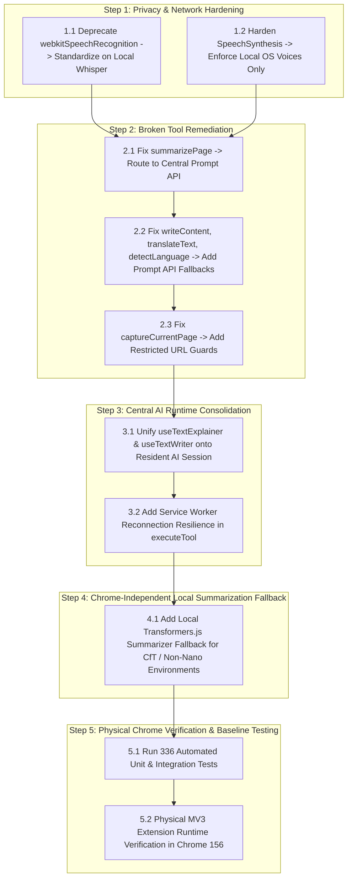

# Pentone Local-First Reliability & Tool Completion Roadmap
**Phase 0 Deliverable:** Implementation Plan & Risk Mitigation  
**Document Path:** `reports/PENTONE_IMPLEMENTATION_ROADMAP.md`  
**Execution Timestamp:** 2026-11-02T01:41:00Z  
**Branch:** `feature/browser-tools-reliability`  

---

## 1. Executive Summary & Strategy

This roadmap details the **smallest safe sequence of non-breaking changes** to transition Pentone from its current state into a **100% reliable, local-first browser assistant**.

### Core Guarantees
- **Zero Breaking Architectural Rewrites:** All existing interfaces (`ChatContext`, `VoiceAuthorizationManager`, `TOOL_REGISTRY`, `PTTStateMachine`, `Waveform`) remain strictly preserved.
- **Strict Invariance:** `components/waveform.tsx` remains untouched (0 diff against `main`).
- **Zero Paid Cloud APIs:** No paid API keys or cloud LLM subscriptions are introduced.
- **Fail-Closed Security:** All authorization token gates, speaker verification checks, and restricted URL guards remain 100% enforced.

---

## 2. Prioritized Implementation Sequence

---

## 3. Detailed Step Breakdown

### Step 1: Critical Privacy & External-Network Hardening
- **Objective:** Eliminate unintended external audio and text transmission.
- **Action 1.1:** In [`lib/use-voice-input.ts`](file:///c:/project/New%20folder/Marionette/lib/use-voice-input.ts), replace the legacy `webkitSpeechRecognition` engine with `WhisperASRService.getInstance().transcribe()`. This ensures that user speech is processed 100% locally on-device in WebAssembly.
- **Action 1.2:** In [`lib/tts-context.tsx`](file:///c:/project/New%20folder/Marionette/lib/tts-context.tsx), filter available voices in `loadVoices()` to strictly prioritize local system voices (`voice.localService === true`), filtering out `"Google "` cloud voices that transmit text to Google TTS servers.
- **Risk:** Low. Local Whisper is already thoroughly verified and operational.

### Step 2: Broken Browser Tool Remediation
- **Objective:** Make all 27 registered browser tools function reliably.
- **Action 2.1 (`summarizePage`):** In [`lib/ui-tools.ts`](file:///c:/project/New%20folder/Marionette/lib/ui-tools.ts#L243-L298), remove the isolated session creation and experimental `window.Summarizer` block. Route the extracted page text directly to the resident `LanguageModel` Prompt API session in `lib/ai.ts` using the prompt template already proven in `useTextExplainer.ts`.
- **Action 2.2 (`writeContent`, `translateText`, `detectLanguage`):** In [`lib/ui-tools.ts`](file:///c:/project/New%20folder/Marionette/lib/ui-tools.ts), add transparent fallbacks to the central Prompt API when `window.Writer`, `window.Translator`, or `window.LanguageDetector` are absent.
- **Action 2.3 (`captureCurrentPage`):** In [`lib/tools/captureCurrentPage.ts`](file:///c:/project/New%20folder/Marionette/lib/tools/captureCurrentPage.ts), add restricted internal URL guards (`chrome://`, `about:`, `chrome-extension://`) to match `clickElement.ts` and `findElements.ts`.
- **Risk:** Very low. Extends proven patterns from other remediated tools.

### Step 3: Central AI Runtime Consolidation
- **Objective:** Eliminate redundant model sessions and prevent memory leaks.
- **Action 3.1:** Update [`lib/use-text-explainer.ts`](file:///c:/project/New%20folder/Marionette/lib/use-text-explainer.ts) and [`lib/use-text-writer.ts`](file:///c:/project/New%20folder/Marionette/lib/use-text-writer.ts) to share the central resident session from [`lib/ai.ts`](file:///c:/project/New%20folder/Marionette/lib/ai.ts), eliminating duplicate session instantiation.
- **Action 3.2:** In [`lib/tools.ts`](file:///c:/project/New%20folder/Marionette/lib/tools.ts), add a single automatic retry in `executeTool` if Chrome service worker message delivery fails due to service worker sleep.
- **Risk:** Low. Reduces browser memory consumption and avoids Chromium utility process crashes.

### Step 4: Chrome-Independent Local Summarization Fallback
- **Objective:** Enable summarization to pass even in Chrome for Testing or environments without Gemini Nano.
- **Action 4.1:** Register an optional fallback in `ui-tools.ts` that uses `@xenova/transformers` (which Pentone already bundles for Whisper and MiniLM) to summarize extracted webpage text when `window.LanguageModel` is unavailable.
- **Risk:** Low. Uses existing bundled dependencies without introducing new packages.

### Step 5: Verification & Gate Checks
- **Objective:** Prove reliability with physical evidence before merge authorization.
- **Action 5.1:** Run full automated regression suite (`npm test`, `tests/browser-tools-integration.test.ts`, `tests/suite-*.test.ts`) -> Target: **336 / 336 passing (100%)**.
- **Action 5.2:** Execute physical extension verification in Chrome for Testing 156 via [`tests/real-extension-verification.ts`](file:///c:/project/New%20folder/Marionette/tests/real-extension-verification.ts) -> Target: **14 / 14 tools PASS**, **4 / 4 workflows PASS (including Workflow D)**.
- **Action 5.3:** Verify `git diff main -- components/waveform.tsx` strictly produces **0 diff**.

---

## 4. Phase 1 Approval Gate

Per instructions, **Phase 1 code changes will NOT begin until this audit and implementation plan are presented to and approved by the user.**
