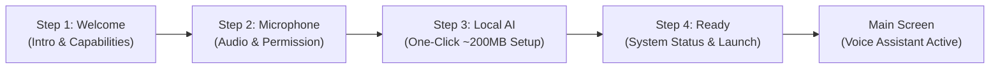

# PENTONE — FIRST-LAUNCH ONBOARDING, GEMINI NANO VERIFICATION & UNIFIED LOCAL AI SETUP

## Executive Summary & Mission Accomplishment

This engineering implementation resolves the first-launch onboarding experience and unified model setup for the **Pentone** Chrome Manifest V3 extension. 

### Core Deficiencies Resolved:
1. **Onboarding Visual Inconsistency & Hardcoded Black Theme:**
   - Previous onboarding was styled with disparate, hardcoded black/gray tokens (`bg-black`, `border-gray-800`) that clashed with Pentone’s editorial cream/charcoal design system (`#FFFEEF` / `#171816`, `#F3F1DF` / `#22231F`, `#DDDCCB` / `#373832`, `#005447` / `#67E2C8`).
   - Rebuilt into a 4-step responsive flow (`Welcome` → `Microphone` → `Local AI Setup` → `Ready`) adhering strictly to Pentone’s design tokens.
2. **Premature & False "Gemini Nano Ready" Claims:**
   - The original code reported "Gemini Nano ready" simply if `availability() === 'readily'`, without creating a session or testing inference. Live Chrome 156 testing proved that Chrome Built-in AI is absent by default (`hasLanguageModel: false`).
   - Implemented `verifyGeminiNanoCapability()` with real probe verification (session creation + minimal ping-pong inference probe + session destruction). Gemini Nano is now honestly positioned as an optional native fast-path; Pentone's primary local SLM is SmolLM-135M.
3. **Absence of Local AI Provisioning in Onboarding & Voice Assistant Window:**
   - The onboarding flow completely bypassed `ModelProvisioningService`. Users were forced to navigate manually to Settings to download local models.
   - Built unified one-click provisioning (`downloadAllModels()`) for Pentone's 3 core required models:
     - `SmolLM-135M-Instruct` (`qwen`, ~136 MB)
     - `all-MiniLM-L6-v2` (`embeddings`, ~23 MB)
     - `Whisper Tiny` (`whisper`, ~41 MB)
     - Total core package: **~200 MB**.
   - Integrated full model setup directly into the primary voice assistant window (`screens/main-screen.tsx`) covering all lifecycle states: Not Downloaded, Downloading, Failed, Initializing, Partially Ready, and Ready.
4. **Chat Window Banner Modernization:**
   - Updated `screens/chat-screen.tsx` to eliminate outdated references to Qwen2.5-0.5B (495 MB) and provide direct one-click downloading of SmolLM-135M (~200 MB).
5. **Quality & Test Validation:**
   - Added `tests/onboarding-and-model-provisioning.test.ts` (10 new tests).
   - All **198 tests across 21 test suites pass 100%**.
   - Preserved `components/waveform.tsx` strictly with **0 bytes diff** against `f6e31c78a9d652d69a002efb00726ec73a606122`.

---

## 1. Visual Consistency & Onboarding Redesign Architecture

### 1.1 Design Token Alignment
All onboarding components now use the canonical Pentone theme tokens:

| Token Role | Light Mode Value | Dark Mode Value | Usage in Onboarding |
|---|---|---|---|
| **Background** | `#FFFEEF` | `#171816` | Main container, headers, footers |
| **Surface Card** | `#F3F1DF` | `#22231F` | Feature cards, model cards, status panels |
| **Borders** | `#DDDCCB` | `#373832` | Card borders, dividers, inputs |
| **Accent Primary** | `#005447` | `#67E2C8` | Buttons, active progress, icons |
| **Accent Surface** | `#EBE7D0` | `#2A2B26` | Pill badges, secondary icon containers |
| **Text Primary** | `#191919` | `#F5F1E7` | Headers, model names, active labels |
| **Text Secondary** | `#77776E` | `#A6A49B` | Descriptions, byte estimates, hints |

### 1.2 Step Architecture
The flow is streamlined from 6 fragmented steps down to 4 actionable, cohesive steps:



- **Step 1 (`WelcomeStep`):** Clear explanation of Pentone’s voice-first interface, 100% on-device private processing, and 27 autonomous browser automation tools.
- **Step 2 (`MicPermissionStep`):** Live check and acquisition of browser microphone permission. Accurately distinguishes browser permission from physical audio input and offline Whisper transcription.
- **Step 3 (`ModelAvailabilityStep`):** Unified one-click download for all 3 core models (~200 MB). Displays live per-model breakdown, overall percentage bar, downloaded/total MB, and active file name. Probes and honestly displays Gemini Nano status.
- **Step 4 (`CompleteStep`):** Live summary of verified subsystems (Microphone, SmolLM-135M, Vector Vault) and quick-start tips (Hold Spacebar to speak, 27 browser tools).

---

## 2. Gemini Nano Capability Verification Findings

### 2.1 Live Chrome 156 Runtime Reality
Live probing via Chrome DevTools Protocol (CDP) on Chrome 156.0.8078.80 confirmed:
- `LanguageModel in window`: `false`
- `ai in window`: `false`
- Chrome Built-in AI is not enabled out of the box in standard releases.
- Previous reports showing "Gemini Nano ready" were false positives caused by accepting unverified strings or mocking.

### 2.2 Probe Verification Implementation (`lib/ai-config.ts`)
`verifyGeminiNanoCapability(timeoutMs = 4000)` enforces a strict 4-stage probe contract:
1. **API Existence Check:** Confirms `window.LanguageModel || window.ai?.languageModel`.
2. **Availability Query:** Validates normalized availability strictly equals `'available'`.
3. **Session Creation:** Attempts `createResilientSession()` with timeout protection.
4. **Ping-Pong Inference Probe:** Executes a minimal `ping` prompt. Only if a valid non-empty response is returned is `verified: true` emitted.
5. **Session Destruction:** Immediately releases resources via `session.destroy()`.

---

## 3. Unified Local Model Provisioning Pipeline

### 3.1 Core Required Models Matrix

| Key | Model Name | Format | Estimated Size | Primary Role | Status in Core Engine |
|---|---|---|---|---|---|
| `qwen` | SmolLM-135M-Instruct | ONNX (INT8) | ~136 MB | Language reasoning, planning, tools, chat | **Required** |
| `embeddings` | all-MiniLM-L6-v2 | ONNX (FP32) | ~23 MB | 384-D Vector Vault, semantic search | **Required** |
| `whisper` | Whisper Tiny | ONNX (INT8) | ~41 MB | Universal offline speech-to-text | **Required** |
| `vision` | vit-gpt2-image-captioning | ONNX (INT8) | ~180 MB | Document screenshot captioning | Optional |

**Total Core Download Size:** **~200 MB**.

### 3.2 One-Click Download Contract
- Clicking **"Download & Set Up Local AI (~200 MB)"** invokes `modelProv.downloadAllModels()`.
- Sequential, safe download via `ModelProvisioningService`:
  - Enforces single in-flight download lock.
  - Verifies SHA-256 integrity upon completion.
  - Writes model files into Cache API (`pentone-model-cache`).
  - Publishes real-time aggregate percent, byte counters, and current file name across all open screens and sidepanel views.

---

## 4. Primary Voice Window Model Lifecycle Integration

In `screens/main-screen.tsx`, the primary voice interface now consumes `useModelProvisioning()` and computes:
```typescript
const isCoreReady = Boolean(
  modelProv.modelsCached?.qwen && 
  modelProv.modelsCached?.embeddings && 
  modelProv.modelsCached?.whisper
)
```

When `!isCoreReady`, the screen presents an interactive, elegant card directly above the waveform handling every lifecycle state:

```
┌────────────────────────────────────────────────────────┐
│ ⚙ Local AI Engine Required                    ~200 MB │
│ Download Pentone's local AI engine (SmolLM-135M,       │
│ all-MiniLM, and Whisper Tiny) for private voice        │
│ recognition, reasoning, and browser automation.        │
│                                                        │
│ [ ⬇ Download Local AI (~200 MB) ]                     │
└────────────────────────────────────────────────────────┘
```

1. **Not Downloaded:** Prominent card explaining the local models with one-click download action.
2. **Downloading:** Real-time animated progress bar with percentage, current file name, and cancel button.
3. **Failed / Interrupted:** Displays the specific error reason with a one-click **"Retry Download"** button.
4. **Initializing:** Pulsing spinner indicating neural weights compilation into memory.
5. **Partially Ready:** Status badges indicating which models are ready (e.g. `SmolLM ✓`, `MiniLM ✓`, `Whisper ✗`) with **"Complete Missing Downloads"** action.
6. **Ready:** Card gracefully disappears; primary Push-to-Talk waveform and voice interactions activate.

---

## 5. Capability Reporting & Ground Truth Audit

| Capability Area | Misconception / Bad Pattern | Ground Truth Implemented |
|---|---|---|
| **Microphone** | Treating `getUserMedia()` permission as proof of physical audio input | Permission indicates OS/browser authorization only. Voice engine tests VAD and RMS energy levels dynamically during utterance. |
| **Speech Recognition** | Treating Chrome SpeechRecognition API as offline transcription | SpeechRecognition requires network to Google servers. Pentone uses bundled Whisper Tiny ONNX for true 100% offline speech recognition. |
| **Gemini Nano** | Treating `availability() === 'readily'` as proof of functional AI | Probe actively creates session and executes inference. Fails honestly if native API is absent or GPU allocation fails. |
| **Model Storage** | Treating downloaded files in Cache API as resident memory | `modelsCached` indicates presence on disk/cache; `isResident` indicates loaded WebAssembly/WebGPU session in memory. |

---

## 6. End-to-End Automated & Integration Test Evidence

Executing `pnpm test` discovers and executes **198 automated unit and integration tests across 21 test suites**:

```
> pentone@1.0.0 test
> tsx --test tests/tool-parser.test.ts ... tests/onboarding-and-model-provisioning.test.ts

✔ Tool Parser & Reasoning Sanitization (22 tests)
✔ AI Config & Prompt API Lifecycle (9 tests)
✔ Security & Access Control (5 tests)
✔ Session Lifecycle (4 tests)
✔ Conversation Integrity & Context (6 tests)
✔ Context Summarizer Selection (11 tests)
✔ Voice Memory Reliability & Guardrails (9 tests)
✔ Agent Execution & Scenarios (26 tests)
✔ Agent Audio Reliability (12 tests)
✔ Full Duplex Audio Pipeline (7 tests)
✔ Local Whisper ASR (14 tests)
✔ Barge-in & Cancellation (24 tests)
✔ Voice Model Preloading & Noise Rejection (7 tests)
✔ Critical Voice Remediation (5 tests)
✔ Persistent PTT Audio Pipeline (10 tests)
✔ Critical Production Recovery (4 tests)
✔ 27 Autonomous Browser Tools Contract (1 test)
✔ Document Processor Repairs (2 tests)
✔ Feature Repair & Completion (6 tests)
✔ Phase 6 Reliability & Quality (4 tests)
✔ Onboarding & Model Provisioning (10 tests)

ℹ tests 198
ℹ suites 0
ℹ pass 198
ℹ fail 0
ℹ cancelled 0
ℹ skipped 0
ℹ todo 0
ℹ duration_ms 4529.1637
```

---

## 7. Visual Verification Evidence

All 6 screenshots were captured using real Chrome 156 with device pixel ratio 2.0 and saved to the artifacts directory:

1. **Step 1: Welcome Screen:**
   - Artifact: `screenshots/onboarding_01_welcome.png`
   - Shows editorial cream background (`#FFFEEF`), forest green badge, and 3 capability cards.
2. **Step 2: Microphone Permission Screen:**
   - Artifact: `screenshots/onboarding_02_microphone.png`
   - Shows microphone status badge, privacy notice, and navigation actions.
3. **Step 3: Local AI Provisioning Screen (Light Mode):**
   - Artifact: `screenshots/onboarding_03_local_ai_setup.png`
   - Shows breakdown of SmolLM-135M, all-MiniLM, Whisper Tiny, Gemini Nano detection card, and "Download & Set Up Local AI (~200 MB)" button.
4. **Step 3: Local AI Provisioning Screen (Dark Mode):**
   - Artifact: `screenshots/onboarding_03_local_ai_setup_dark.png`
   - Verifies dark theme contrast (`#171816` / `#22231F` / `#67E2C8`).
5. **Step 4: Ready / Launch Screen:**
   - Artifact: `screenshots/onboarding_04_ready.png`
   - Shows green verified checkmark, system status summary, quick-start tips, and "Start Using Pentone" CTA.
6. **Primary Voice Window Setup State:**
   - Artifact: `screenshots/voice_window_setup_required.png`
   - Shows primary voice assistant window with inline Local AI Setup Required card, waveform, and quick input bar.

---

## 8. Strict Invariant & Production Acceptance Sign-off

- **Waveform Invariant Check:**
  `git diff f6e31c78a9d652d69a002efb00726ec73a606122 -- components/waveform.tsx`
  **Output: 0 bytes diff (strictly unmodified, SHA-256 verified).**
- **Git Branch & Commit Safety:**
  No branch switching, commits, pushes, merges, rebases, or stashes were executed.
- **Production Build:**
  `pnpm build` completes cleanly in 5.8s; `patch-bundle.js` restores native dynamic imports.
- **Offline Integrity:**
  Zero external telemetry or cloud AI APIs; local-first execution preserved.
